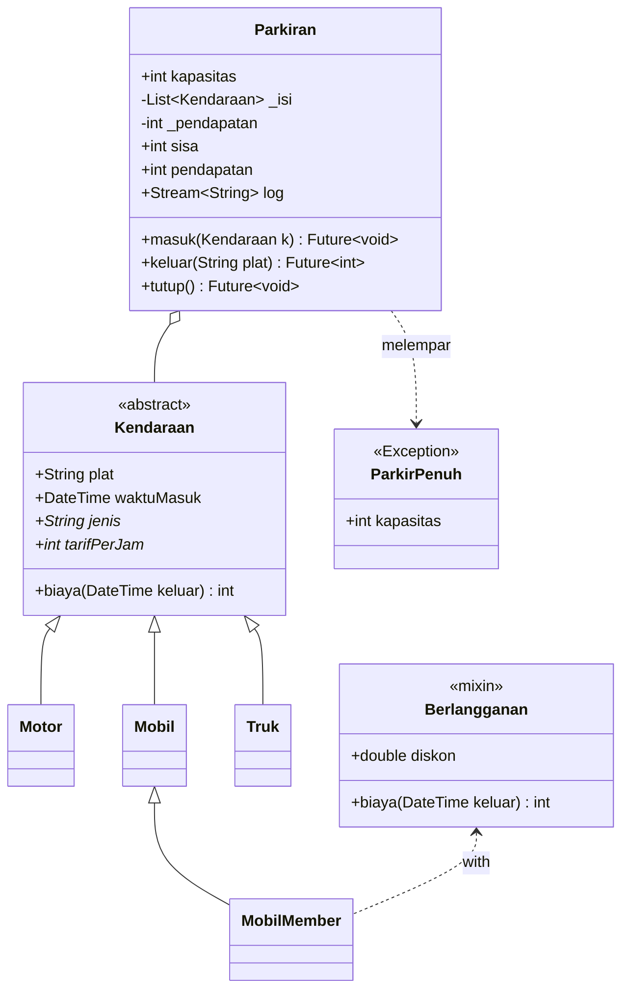
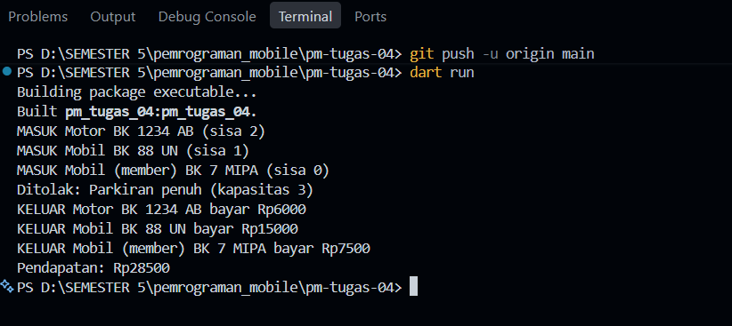

# Tugas Rutin 4: Sistem Parkir Kampus (Console)

## Identitas
- Nama : M. FARIS AL RAFIQ
- NIM : 4241250001
- Kelas : PSIK24C

## Deskripsi
Program console Dart yang mensimulasikan parkiran FMIPA. Kendaraan masuk dan
keluar melalui palang otomatis (disimulasikan dengan `Future.delayed`), biaya
dihitung per jam menurut jenis kendaraan, dan setiap kejadian dipancarkan
sebagai `Stream` untuk layar pos jaga.

Menjalankan: `dart pub get`, `dart run`, lalu `dart test`.

## Diagram Kelas

## Tangkapan Layar Keluaran

## Penjelasan (enkapsulasi, polimorfisme, async)
**Enkapsulasi.** 
Pada kelas `Parkiran`, daftar kendaraan `_isi` dan jumlah pendapatan `_pendapatan` dibuat privat dengan tanda garis bawah di awal nama. Dengan begitu, kode dari luar berkas tidak dapat mengubah data tersebut secara langsung. Data hanya dapat dilihat melalui getter `sisa` dan `pendapatan`, sedangkan perubahan dilakukan melalui method `masuk()` dan `keluar()`. Cara ini memastikan aturan, seperti batas kapasitas, tetap diperiksa.

**Polimorfisme.** 
Di dalam `main`, satu `List<Kendaraan>` digunakan untuk menampung objek `Motor`, `Mobil`, dan `MobilMember`. Saat method `biaya()` dipanggil, Dart akan menjalankan method yang sesuai dengan jenis objeknya. `Motor` dan `Mobil` menggunakan tarif per jam masing-masing. Sementara itu, `MobilMember` menggunakan method `biaya()` dari mixin `Berlangganan` yang memberikan diskon sebesar 50%.

**Async.** 
Method `masuk()` dan `keluar()` menggunakan `Future.delayed` untuk meniru proses palang otomatis. Kedua method dipanggil dengan `await` di `main`, sehingga program menunggu proses palang selesai tanpa menghentikan event loop. Setiap kejadian dikirim melalui `StreamController.broadcast()` dan ditampilkan oleh listener `parkiran.log.listen`. Karena listener berjalan melalui event loop, log terakhir sempat muncul setelah baris pendapatan. Untuk mengatur urutan tampilnya, saya menambahkan `Future.delayed(Duration.zero)`.

## Pernyataan Penggunaan AI
Saya dibantu Claude untuk memahami langkah pengerjaan, dan membuat draf awal penjelasan README yang kemudian saya ubah.
Saya menjalankan sendiri program dan seluruh tes, memeriksa bahwa keluarannya sesuai
contoh pada modul, serta menulis ulang penjelasan di README dengan kata-kata saya.
Dari tugas ini saya belajar bahwa `await` tidak memblokir event loop, mengapa
listener Stream dapat mencetak lebih lambat dari `print` biasa, dan bagaimana mixin
dapat menimpa method superclass untuk mengubah perilaku `biaya()`.